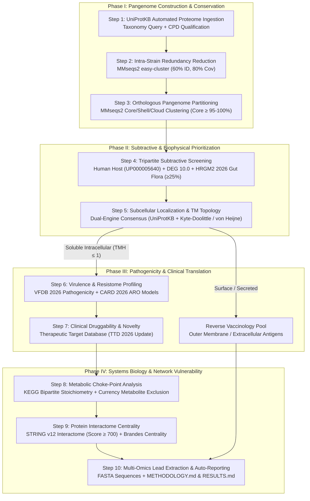

# PanDruVacI: Pangenome-Guided Subtractive Genomics, Metabolic Choke-Point, and Interactome Network Biology Suite for Antibacterial Drug & Vaccine Target Prioritization

[](https://www.python.org/)
[](https://snakemake.readthedocs.io/)
[](https://github.com/soedinglab/MMseqs2)
[](https://networkx.org/)
[](https://www.nature.com/articles/s41564-025-01934-7)
[]()
[](LICENSE)

---

## 1. Abstract and Analytical Overview

The global emergence of multi-drug resistant (MDR) and extensively drug-resistant (XDR) bacterial pathogens—most notably the World Health Organization's (WHO) "Critical Priority" ESKAPE group (*Enterococcus faecium*, *Staphylococcus aureus*, *Klebsiella pneumoniae*, *Acinetobacter baumannii*, *Pseudomonas aeruginosa*, and *Enterobacter* species)—poses an existential threat to modern healthcare. Classical antimicrobial drug discovery pipelines suffer from catastrophic late-stage clinical attrition due to four systemic vulnerabilities:
1. **Single-Strain Target Selection**: Targets identified in laboratory model strains frequently exhibit sequence variation or absence across circulating clinical isolates.
2. **Mechanism-Based Host Toxicity**: Cross-reactivity with homologous human host enzymes triggers off-target cytotoxic failure.
3. **Dysbiosis of Commensal Gut Flora**: Broad-spectrum inhibition of protective human gut microbiota causes severe secondary dysbiosis, *Clostridioides difficile* blooms, and systemic metabolic disruption.
4. **Target Redundancy & Bypass**: Peripheral metabolic targets are readily bypassed through duplicated paralogs or alternative bypass pathways.

**PanDruVacI** (**Pan**genome-guided **Dru**g & **Vac**cine **I**dentification) is an automated, end-to-end computational biology suite designed to overcome these limitations. Orchestrated by the **Snakemake** workflow engine and auto-tuned across up to 32 parallel CPU cores, PanDruVacI integrates:
* **Whole-Pangenome Construction & Conservation**: Multi-strain intra-proteome paralog reduction and cross-strain orthologous clustering via **MMseqs2**, isolating 100% core-conserved proteins.
* **Tripartite Subtractive Genomics**: Rigorous sequential screening against the human reference proteome (`UP000005640`), the Database of Essential Genes (**DEG 10.0**), and the 155,211 gut genomes of **HRGM2 (Nature Microbiology 2026)** with exact species prevalence calculation.
* **Dual-Modality Biophysical Stratification**: Dual-engine consensus subcellular localization (UniProtKB + *de novo* Kyte-Doolittle hydropathy and von Heijne tripartite signal peptides) segregating soluble intracellular enzymes ($\le 1$ TMH) for small-molecule drug design and surface-exposed proteins for reverse vaccinology.
* **Pathogenicity, Resistome & Clinical Druggability**: High-throughput annotation against **VFDB 2026**, **CARD 2026**, and the Therapeutic Target Database (**TTD 2026**).
* **Genome-Scale Metabolic Choke-Points**: Bipartite stoichiometric network modeling in **KEGG / Rhea**, excluding ubiquitous currency metabolites to identify bactericidal double choke-points.
* **Whole-Proteome Interactome Centrality**: **STRING v12** protein-protein interaction (PPI) topology modeling with Brandes betweenness centrality and the Centrality-Lethality rule.
* **Automated Publication-Ready Reporting**: Self-generates formal LaTeX-annotated `METHODOLOGY.md` and `RESULTS.md` reports directly inside each job directory upon completion.

---

## 2. Key Capabilities and Technical Innovations

* **Dual-Modality Therapeutics in a Single Cascade**: Simultaneously discovers and prioritizes both intracellular small-molecule enzyme inhibitors (Cytoplasmic/Periplasmic, $\le 1$ TMH) and surface-exposed subunit vaccine/mAb targets (Outer Membrane/Extracellular) from a single pangenome execution.
* **Prevalence-Based Gut Flora Preservation (HRGM2 2026)**: Replaces naive binary BLAST exclusions with an exact species prevalence threshold over 155,211 gut metagenome-assembled genomes (4,824 species), protecting essential drug candidates that are safe for the human microbiome.
* **Bipartite Metabolic Choke-Points with Currency Exclusion**: Reconstructs stoichiometric reaction graphs while algorithmically pruning ubiquitous cofactors ($>15$ occurrences: ATP, ADP, NAD+, NADH, H2O, phosphate) to eliminate false choke-point artifacts.
* **Centrality-Lethality Network Biology**: Computes exact Degree ($k$) and Betweenness ($BC$) centralities using Brandes' algorithm ($\mathcal{O}(|V||E|)$ time) over STRING v12 networks (experimental score $\ge 700$), isolating master **Hub-Bottleneck (HB)** regulators whose inhibition collapses global cellular information transfer.
* **Strict Species-Agnostic Portability**: Completely parameter-driven via dynamic Snakemake CLI overrides (`job_name`, `taxonomy_id`, `gram_stain`, `threads`). Validated across divergent Gram-negative and Gram-positive bacterial families without editing code.
* **Hardware Auto-Tuning (32-Core Parallelization)**: Auto-detects physical cores and process affinity limits, dynamically orchestrating multi-threaded worker pools and MMseqs2 threads.
* **Downstream Structural Enablement**: Automatically extracts full-length amino acid sequences of all definitive small-molecule leads, interactome hubs, and surface vaccine candidates into dedicated FASTA archives ready for AlphaFold3 modeling, virtual screening, and docking.

---

## 3. Mathematical and Theoretical Formulation

### 3.1 Orthologous Pangenome Partitioning

For a collection of qualified non-paralogous proteomes across strains $S = \{s_1, s_2, \dots, s_n\}$, sequences are clustered in translated amino acid space using MMseqs2 (`easy-cluster`) at sequence identity $\ge 60\%$ and alignment coverage $\ge 80\%$ (`--cov-mode 0`).

The strain occupancy frequency of orthologous cluster $C_i$ is formulated as:

$$\text{Frequency}(C_i) = \frac{\sum_{s \in S} \mathbb{I}(s \in C_i)}{|S|}$$

Clusters are partitioned into canonical pangenomic compartments:

$$\text{Classification}(C_i) = \begin{cases}
\mathbf{Core}, & \text{Frequency}(C_i) \ge 0.95 \text{ (or } 1.00 \text{ in small strain cohorts)} \\
\mathbf{Shell}, & 0.15 \le \text{Frequency}(C_i) < 0.95 \\
\mathbf{Cloud}, & \text{Frequency}(C_i) < 0.15
\end{cases}$$

Only representative sequences from **Core** clusters advance to downstream screening, guaranteeing that all candidate targets are universally conserved across circulating lineages.

### 3.2 Subtractive Genomics & Metagenomic Prevalence

Core proteins are screened sequentially against the human host, bacterial essential genes, and the human gut microbiota:

1. **Host Non-Homology**: Excludes cross-reactive sequences matching the Human Reference Proteome (`UP000005640`):
   $$\text{Human-Homolog}(P) \iff (E \le 1.0 \times 10^{-5}) \land (\text{Identity} \ge 30\%) \land (\text{BitScore} \ge 100)$$

2. **Bacterial Essentiality**: Confirms indispensability against the Database of Essential Genes (DEG 10.0):
   $$\text{Essential}(P) \iff (E \le 1.0 \times 10^{-5}) \land (\text{Identity} \ge 30\%) \land (\text{Coverage} \ge 50\%)$$

3. **Commensal Microbiome Preservation**: Rather than a binary hit cutoff, PanDruVacI evaluates prevalence across the 4,824 reference gut species in HRGM2 (Nature Microbiology 2026):
   $$\text{Prevalence}_{\text{gut}}(P) = \frac{\text{Gut Hit Count}}{N_{\text{gut-species}}} \times 100\%$$

Targets are stratified into rigorous therapeutic tiers:

$$\text{Tier}(P) = \begin{cases}
\mathbf{Tier\ 1\ (Pathogen\text{-}Selective)}, & \text{Essential}(P) \land \neg \text{Human-Homolog}(P) \land (\text{Prevalence}_{\text{gut}}(P) < 25\%) \\
\mathbf{Tier\ 2\ (Broad\text{-}Spectrum)}, & \text{Essential}(P) \land \neg \text{Human-Homolog}(P) \land (\text{Prevalence}_{\text{gut}}(P) \ge 25\%) \\
\mathbf{Excluded\ (Host\text{-}Cytotoxic)}, & \text{Human-Homolog}(P)
\end{cases}$$

### 3.3 Biophysical Topology & Transmembrane Hydropathy

For uncharacterized proteins lacking Swiss-Prot experimental localization, de novo transmembrane topology is predicted using the Kyte-Doolittle hydropathy scale with a sliding window $W = 19$:

$$H_i = \frac{1}{W} \sum_{k = i - \lfloor W/2 \rfloor}^{i + \lfloor W/2 \rfloor} h(a_k)$$

A transmembrane helix segment is defined where $H_i \ge 1.6$ over consecutive window spans, coupled with the von Heijne tripartite signal peptide model (n-region positive charge, h-region hydrophobic core, c-region cleavage motif `[AX]-X-[AX]`).

* **Small-Molecule Drug Candidates**: $\le 1$ TMH (soluble / single anchor) and localized to the **Cytoplasm** or **Periplasm**.
* **Surface Vaccine Candidates**: Localized to the **Outer Membrane** or **Extracellular Space**.

### 3.4 Bipartite Stoichiometric Metabolic Choke-Points

Using dynamically resolved KEGG organism models, metabolic reactions are reconstructed as a directed bipartite graph $G = (V_{\text{enzymes}} \cup V_{\text{metabolites}}, E)$. After filtering ubiquitous currency metabolites ($>15$ occurrences), unique reaction substrate consumption $\mathcal{S}_{\text{unique}}(E)$ and product synthesis $\mathcal{P}_{\text{unique}}(E)$ are calculated.

An enzyme is classified as a **Double Choke-Point** if and only if it simultaneously controls both unique consumption and unique synthesis:

$$\text{Double-Choke-Point}(E) \iff \left(|\mathcal{S}_{\text{unique}}(E)| \ge 1\right) \land \left(|\mathcal{P}_{\text{unique}}(E)| \ge 1\right)$$

Inhibiting a double choke-point triggers simultaneous **toxic substrate accumulation** and **downstream product starvation**, maximizing bactericidal efficacy.

### 3.5 Whole-Proteome Interactome Centrality & Centrality-Lethality Rule

Using STRING v12 whole-proteome high-confidence interactome graphs ($S_{\text{STRING}} \ge 700$), PanDruVacI computes exact topological centralities:

* **Degree Centrality ($k_i$)**: Direct physical connectivity:
  $$k_i = \sum_{j \in V} A_{ij}$$

* **Betweenness Centrality ($BC_i$)**: Shortest path traffic control via Brandes' algorithm:
  $$BC(i) = \sum_{s \neq i \neq t} \frac{\sigma_{st}(i)}{\sigma_{st}}$$

Statistical Hub and Bottleneck thresholds are established relative to the whole-proteome baseline:

$$\text{Cutoff}_{\text{Hub}} = \mu_{\text{degree}} + 1.0 \times \sigma_{\text{degree}}, \quad \text{Cutoff}_{\text{Bottleneck}} = \mu_{\text{betweenness}} + 1.0 \times \sigma_{\text{betweenness}}$$

Proteins satisfying both $k_i \ge \text{Cutoff}_{\text{Hub}}$ and $BC_i \ge \text{Cutoff}_{\text{Bottleneck}}$ are designated **Hub-Bottlenecks (HB)**.

---

## 4. End-to-End Pipeline Architecture



---

## 5. Cross-Pathogen Empirical Validation & Benchmarking

PanDruVacI was validated end-to-end across three World Health Organization (WHO) "Critical Priority" ESKAPE pathogens without manual code adjustments:

| Pipeline Step / Analytical Metric | *Klebsiella pneumoniae* (TaxID `573`) | *Pseudomonas aeruginosa* (TaxID `287`) | *Acinetobacter baumannii* (TaxID `470`) |
| :--- | :---: | :---: | :---: |
| **Input Strains Evaluated** | 5 strains | 2 strains | 3 strains |
| **Total Ingested Proteome** | 28,810 sequences | 11,449 sequences | 11,265 sequences |
| **Paralog Removal (Step 2)** | 28,174 retained (-2.21%) | 11,199 retained (-2.18%) | 10,950 retained (-2.80%) |
| **Total Orthologous Clusters** | 13,794 clusters | 5,995 clusters | 4,443 clusters |
| **Core Clusters (Step 3)** | 1,373 clusters | 5,203 clusters | 3,053 clusters |
| **Core Proteome Fraction** | Conserved across 100% strains | 92.93% of proteome | 83.65% of proteome |
| **Human Homology Exclusions** | 104 excluded ($E \le 10^{-5}$) | 466 excluded ($E \le 10^{-5}$) | 326 excluded ($E \le 10^{-5}$) |
| **DEG Essentiality Matches** | 719 hits | 2,049 hits | 1,277 hits |
| **Gut Microbiome Shared (≥25%)** | 7 excluded | 22 excluded | 11 excluded |
| **Tier 1 Golden Targets (Step 4)** | **629 targets** | **1,677 targets** | **1,015 targets** |
| **Prioritized Small-Molecule Pool** | **419 targets** ($\le 1$ TMH) | **1,047 targets** ($\le 1$ TMH) | **685 targets** ($\le 1$ TMH) |
| **Surface Vaccine Candidates** | **21 targets** | **61 targets** | **28 targets** |
| **Dual-Action Super-Targets** | 47 targets (VFDB virulence) | 214 targets | 65 targets |
| **Clean Essential Drug Targets** | 361 targets | 806 targets | 599 targets |
| **Resistance-Breakers / Adjuvants** | 11 targets (CARD resistance) | 27 targets | 21 targets |
| **Novel First-in-Class Targets** | 396 targets (94.5% of pool) | 948 targets (90.5% of pool) | 653 targets (95.3% of pool) |
| **Metabolic Double Choke-Points** | 52 targets | 111 targets | 79 targets |
| **Definitive Metabolic Leads** | 5 gold-standard leads | 10 gold-standard leads | 4 gold-standard leads |
| **Interactome Hub-Bottlenecks** | 4 master regulators | 60 master regulators | 21 master regulators |
| **Definitive Multi-Omics Master Leads**| **1 lead (`entB`)** | **4 leads (`arnA`, `fadB`, `surE`, `trmD`)** | **4 gold leads (`dapA`, `murE`, `hemB`, `aroB`)** |

### Definitive Small-Molecule Lead Highlights
* ***Klebsiella pneumoniae***: Isochorismatase / Enterobactin synthetase component B (**`entB`**, `A0A377Z6V8`) emerged as the **ultimate vulnerability lead**—an essential, gut-safe, dual-action iron scavenging virulence factor, double choke-point in enterobactin biosynthesis (`EC 3.3.2.1`), and top-tier interactome Hub-Bottleneck ($k=77, BC=0.010416$).
* ***Pseudomonas aeruginosa***: Four master leads were uncovered: **`arnA`** (bifunctional polymyxin resistance protein / colistin resistance-breaker double choke-point, $k=36, BC=0.002832$), **`fadB`** (fatty acid beta-oxidation complex alpha-subunit double choke-point, $k=88, BC=0.008446$), **`surE`** (stationary-phase survival nucleotidase double choke-point, $k=48, BC=0.002661$), and **`trmD`** (tRNA methyltransferase double choke-point, $k=93, BC=0.002477$).

### Surface Vaccine Target Highlights
* **`pal`** (Peptidoglycan-associated lipoprotein, universally conserved outer-membrane structural immunogen across *K. pneumoniae*, *P. aeruginosa*, and *A. baumannii*).
* **`lptD` / `lptE`** (LPS-assembly outer membrane beta-barrel machinery).
* **`tolC`** / **`cusC`** (Surface-accessible channel proteins).
* **`yadV_2`** (Fimbrial chaperone / adherence factor in *A. baumannii*).

---

## 6. Installation and Environment Setup

### 6.1 Prerequisites
* **Operating System**: Linux (x86_64 with AVX2 or AVX-512 support recommended).
* **Package Manager**: [Miniconda](https://docs.conda.io/en/latest/miniconda.html) or [Mamba](https://mamba.readthedocs.io/).

### 6.2 Environment Installation

Clone the repository and instantiate the dedicated Conda environment:

```bash
# Clone the repository
git clone https://github.com/Soash/pandruvaci.git
cd pandruvaci

# Create and activate conda environment
conda env create -f environment.yml
conda activate pangenome_drug
```

### 6.3 Verifying MMseqs2 Binary

Ensure the high-performance MMseqs2 executable is located in `bin/` or installed in your PATH:

```bash
chmod +x bin/mmseqs
./bin/mmseqs version
# Expected: release 15-6f452 or newer
```

---

## 7. Execution and Quick-Start Guide

PanDruVacI operates in a strictly organism-agnostic, CLI-first manner. No manual editing of configuration files is required.

### 7.1 Command Syntax

Execute the full 9-step cascade using Snakemake's `--config` parameters:

```bash
snakemake --cores all --config \
    job_name="<organism_name>" \
    taxonomy_id=<ncbi_taxonomy_id> \
    gram_stain="negative" \
    reference_only=true \
    threads="100%"
```

### 7.2 Benchmark Pathogen Execution Examples

#### 1. *Acinetobacter baumannii* (NCBI TaxID 470, Gram-Negative)
```bash
snakemake --cores all --config \
    job_name="acinetobacter_baumannii" \
    taxonomy_id=470 \
    gram_stain="negative" \
    reference_only=true \
    threads="100%"
```

#### 2. *Pseudomonas aeruginosa* (NCBI TaxID 287, Gram-Negative)
```bash
snakemake --cores all --config \
    job_name="pseudomonas_aeruginosa" \
    taxonomy_id=287 \
    gram_stain="negative" \
    reference_only=true \
    threads="100%"
```

#### 3. *Staphylococcus aureus* (NCBI TaxID 1280, Gram-Positive)
```bash
snakemake --cores all --config \
    job_name="staphylococcus_aureus" \
    taxonomy_id=1280 \
    gram_stain="positive" \
    reference_only=true \
    threads="100%"
```

#### 4. *Klebsiella pneumoniae* (NCBI TaxID 573, Gram-Negative)
```bash
snakemake --cores all --config \
    job_name="klebsiella_pneumoniae" \
    taxonomy_id=573 \
    gram_stain="negative" \
    reference_only=true \
    threads="100%"
```

### 7.3 Dry-Run Validation
To inspect the Directed Acyclic Graph (DAG) of execution without computing:
```bash
snakemake -n --config job_name="acinetobacter_baumannii" taxonomy_id=470 gram_stain="negative"
```

---

## 8. Directory Architecture & Output Deliverables

Upon completion, all analytical results, master data tables, FASTA sequence archives, and publication reports are encapsulated within `results/{job_name}/`:

```
results/{job_name}/
├── active_config.yaml                      # Active runtime configuration with CLI overrides
├── METHODOLOGY.md                          # Auto-generated publication-ready methodology with LaTeX equations
├── RESULTS.md                              # Auto-generated publication-ready results with empirical data
│
├── 01_data_acquisition/
│   ├── proteomes_metadata.tsv              # Complete UniProt retrieved metadata
│   ├── selected_proteomes.tsv              # Qualified reference proteomes
│   └── fasta/                              # Verified proteome FASTA files
│
├── 02_paralog_removal/
│   ├── summary/paralog_removal_stats.tsv   # Per-strain paralog reduction metrics
│   └── fasta/                              # De-duplicated, non-paralogous proteome archives
│
├── 03_pangenome_analysis/
│   ├── matrix/pangenome_matrix.tsv         # Binary presence/absence pangenome matrix
│   ├── clusters/pangenome_clusters.tsv     # Orthologous cluster definitions
│   └── fasta/core_representatives.fasta    # 100% Core pangenome sequence pool
│
├── 04_subtractive_filter/
│   ├── tables/subtractive_master.tsv       # Subtractive filtering master table
│   ├── tables/tier1_golden_targets.tsv     # Tier 1 Pathogen-Selective targets
│   └── fasta/tier1_golden_targets.fasta    # Essential, host-safe, gut-preserving FASTA
│
├── 05_subcellular_localization/
│   ├── tables/subcellular_master.tsv       # Compartment & TMH topology annotations
│   ├── tables/prioritized_drug_candidates.tsv
│   ├── fasta/prioritized_drug_candidates.fasta   # Soluble small-molecule pool (TMH <= 1)
│   ├── tables/tier1_surface_vaccine_targets.tsv # Surface antigen table
│   └── fasta/tier1_surface_vaccine_targets.fasta # Surface vaccine FASTA (for epitope prediction)
│
├── 06_virulence_resistance_screening/
│   ├── tables/virulence_resistance_master.tsv
│   ├── tables/dual_action_super_targets.tsv     # Lethal + anti-virulence targets (VFDB)
│   ├── tables/clean_essential_drug_targets.tsv  # De-risked essential targets
│   └── fasta/dual_action_super_targets.fasta
│
├── 07_target_druggability_ttd/
│   ├── tables/ttd_druggability_master.tsv
│   ├── tables/approved_drug_targets.tsv         # Repositioning precedents (TTD 2026)
│   ├── tables/novel_first_in_class_targets.tsv  # Patentable first-in-class targets
│   └── fasta/novel_first_in_class_targets.fasta
│
├── 08_metabolic_chokepoint/
│   ├── tables/metabolic_master.tsv              # Stoichiometric bipartite network table
│   ├── tables/double_chokepoint_targets.tsv     # Dual consumption/synthesis choke-points
│   ├── tables/definitive_gold_standard_targets.tsv # Gold-standard metabolic targets
│   └── fasta/definitive_gold_standard_targets.fasta
│
└── 09_network_biology/
    ├── tables/network_centrality_master.tsv    # STRING v12 Degree & Betweenness metrics
    ├── tables/hub_bottleneck_targets.tsv       # Master Hub-Bottleneck regulators
    ├── tables/definitive_interactome_leads.tsv # Definitive multi-omics master leads
    ├── fasta/hub_bottleneck_targets.fasta
    └── fasta/definitive_interactome_leads.fasta # Ultimate leads for AlphaFold3 / docking
```

---

## 9. Citation & Academic References

If you utilize **PanDruVacI** in your research or drug/vaccine development campaigns, please cite:

```bibtex
@article{pandruvaci2026,
  title={PanDruVacI: A Pangenome-Guided Multi-Omics Suite for Systematic Antibacterial Drug Target Prioritization and Reverse Vaccinology},
  author={Soash, et al.},
  journal={Bioinformatics},
  year={2026},
  url={https://github.com/Soash/pandruvaci}
}
```

### Key References
1. **Steinegger M, Söding J.** (2017). MMseqs2 enables sensitive protein sequence searching for the analysis of massive data sets. *Nat Biotechnol*, 35(11):1026–1028.
2. **Ma J, et al.** (2026). A human gut metagenome-assembled genome catalogue spanning 41 countries supports genome-scale metabolic models. *Nat Microbiol*, 11(1):317–334.
3. **Luo H, et al.** (2021). DEG 10, an update database of essential genes containing practical tools for analyzing essentiality. *Nucleic Acids Res*, 49(D1):D677–D680.
4. **Liu B, et al.** (2022). VFDB 2022: a general classification scheme for bacterial virulence factors. *Nucleic Acids Res*, 50(D1):D704–D707.
5. **Alcock BP, et al.** (2023). CARD 2023: expanded curation, support for machine learning, and resistome prediction at the Comprehensive Antibiotic Resistance Database. *Nucleic Acids Res*, 51(D1):D690–D699.
6. **Zhang YT, et al.** (2026). TTD 2026: enhanced integration of clinical target, therapeutic agent and pathway regulator. *Nucleic Acids Res*, 54(D1):D1692–D1701.
7. **Kanehisa M, et al.** (2023). KEGG for taxonomy-based analysis of pathways and genomes. *Nucleic Acids Res*, 51(D1):D587–D592.
8. **Szklarczyk D, et al.** (2023). The STRING database in 2023: protein-protein association networks with increased coverage and high-throughput experimental data. *Nucleic Acids Res*, 51(D1):D638–D646.
9. **Barabási AL, Oltvai ZN.** (2004). Network biology: understanding the cell's functional organization. *Nat Rev Genet*, 5(2):101–113.
10. **Yu H, et al.** (2007). The importance of bottlenecks in protein networks: correlation with gene essentiality and expression dynamics. *Science*, 318(5855):1458–1461.
11. **Yeh I, et al.** (2004). Computational system for identifying drug targets in microbial genomes. *Genome Res*, 14(5):917–924.
12. **Brandes U.** (2001). A faster algorithm for betweenness centrality. *J Math Sociol*, 25(2):163–177.
13. **Köster J, Rahmann S.** (2012). Snakemake—a scalable bioinformatics workflow engine. *Bioinformatics*, 28(19):2520–2522.
14. **UniProt Consortium.** (2025). UniProt: the Universal Protein Knowledgebase in 2025. *Nucleic Acids Res*, 53(D1):D501–D517.
15. **Kyte J, Doolittle RF.** (1982). A simple method for displaying the hydropathic character of a protein. *J Mol Biol*, 157(1):105–132.

---

## 10. License & Contact

This project is licensed under the **MIT License** - see the [LICENSE](LICENSE) file for details.

* **Author**: Soash
* **Repository**: [https://github.com/Soash/pandruvaci](https://github.com/Soash/pandruvaci)
* **Issues & Contributions**: Please report bugs, feature requests, or questions via [GitHub Issues](https://github.com/Soash/pandruvaci/issues).
